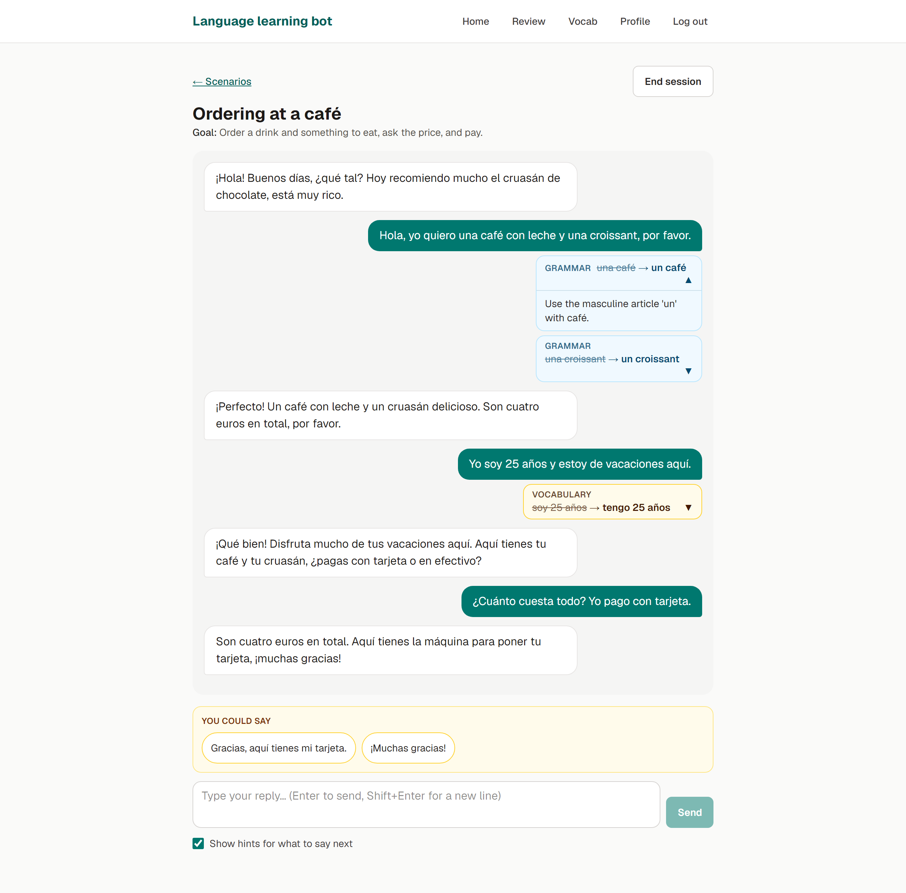
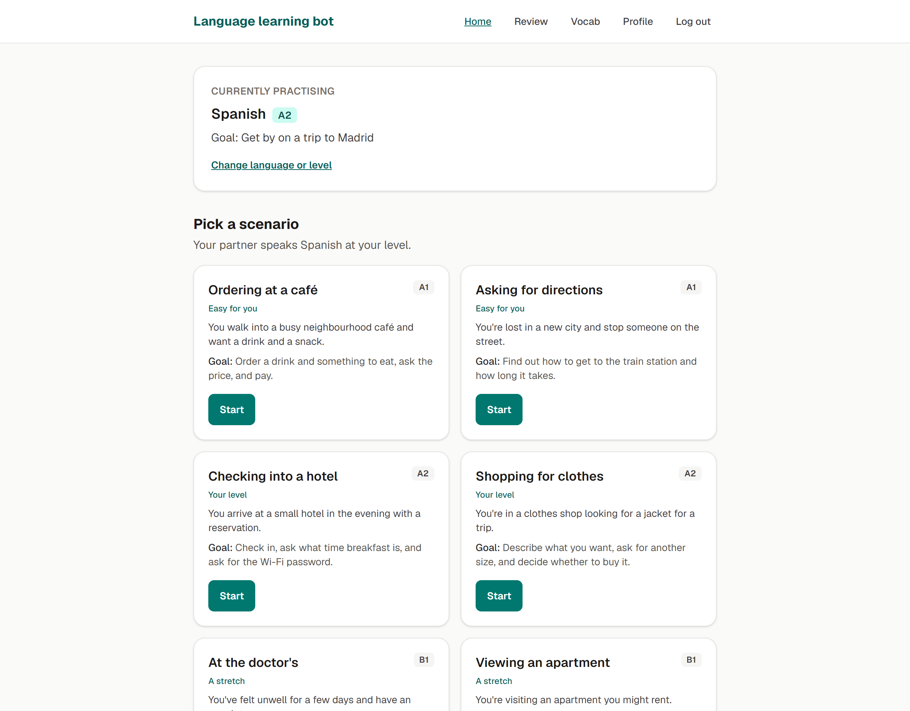
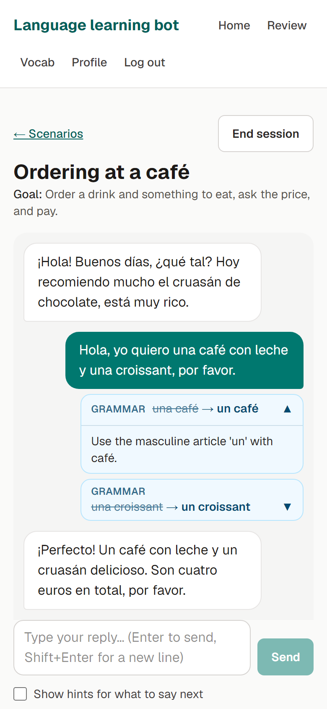
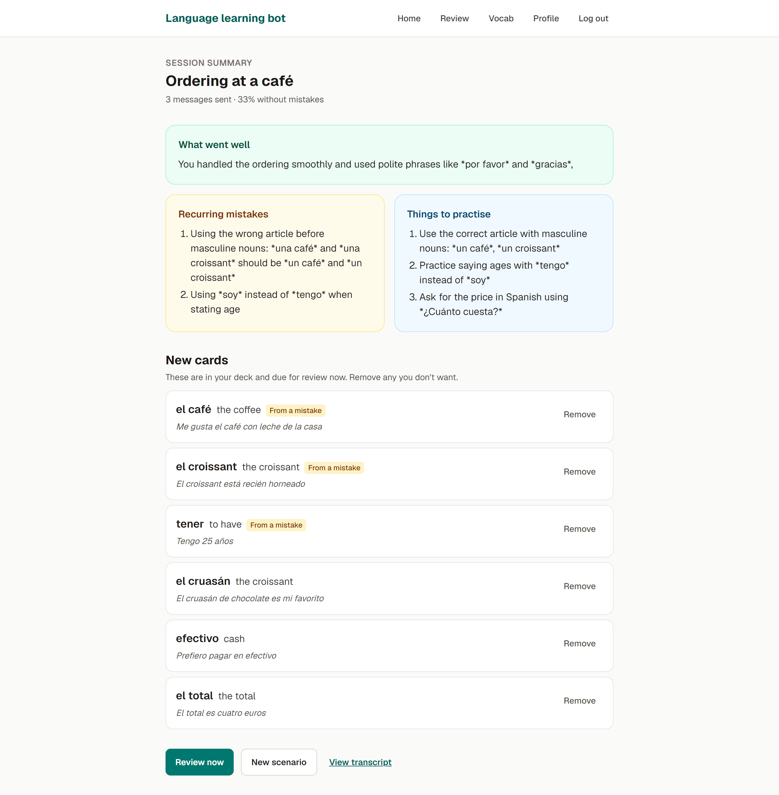
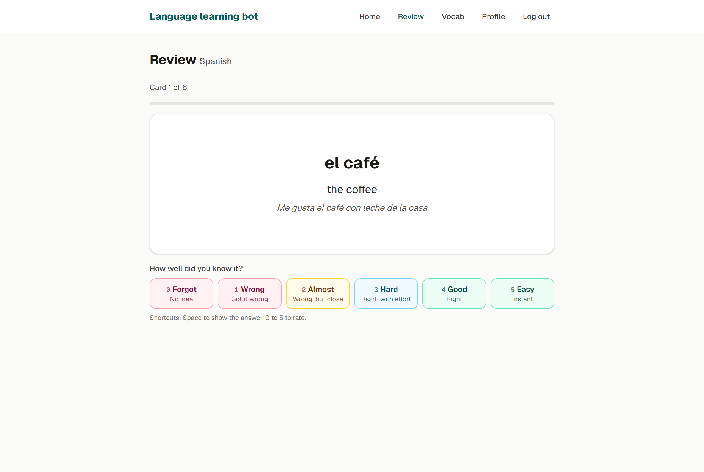
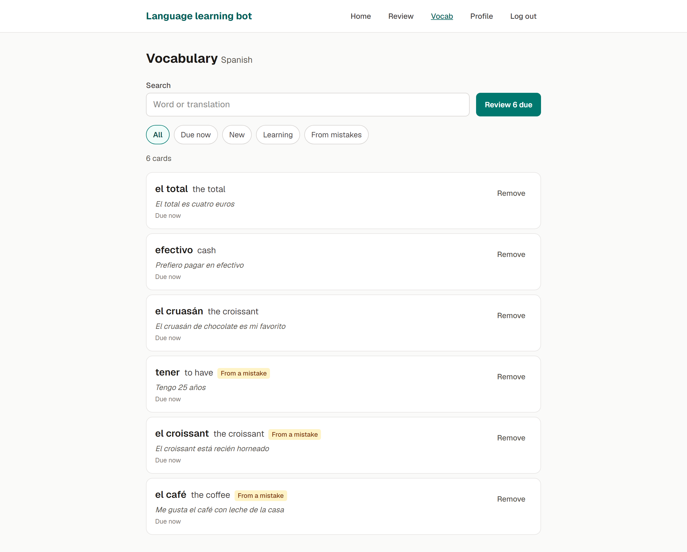
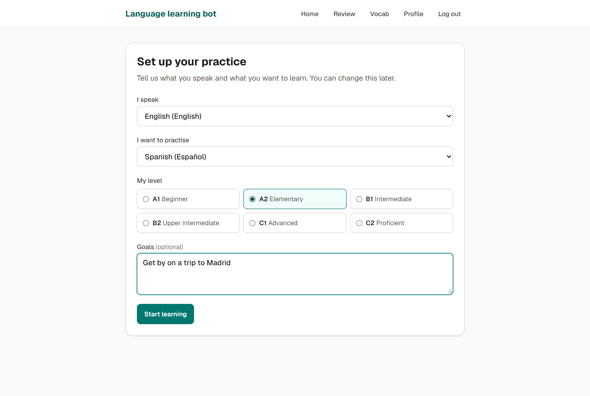

# Language learning bot

Practise a language by role-playing real situations with an AI partner. Order coffee, check
into a hotel, or get through a job interview. You get gentle corrections after every message,
and the words you got wrong turn into flashcards you review over time.



## Features

### Role-play scenarios
- Nine ready-made scenes, from beginner to advanced: ordering at a café, asking for
  directions, checking into a hotel, shopping for clothes, a visit to the doctor, viewing an
  apartment, a job interview, returning a faulty product, and a debate about city plans.
- Each scene has a character for the partner to play and a goal for you to reach.
- Scenario cards show whether a scene is easy, at your level, or a stretch.



### Conversations at your level
- The partner speaks only your target language and stays in character, even if you try to
  talk it out of its role.
- Replies match your level: one to three short, simple sentences for beginners, and longer,
  more natural speech at higher levels.
- The partner never interrupts to correct you. It uses the right form in its reply instead.
- If you write in your own language, the partner answers in simpler target-language words.
- Replies appear as they are written.
- Stuck? Turn on **hints** for two suggestions of what to say next. Click one to use it.

### Gentle corrections
- Every message you send is checked in the background while the partner replies.
- Mistakes show as small chips under your message, for example
  ~~una café~~ → **un café**. Click a chip to see why, explained in your own language.
- Chips are colour-coded by how serious the mistake is, and each is labelled by type:
  grammar, vocabulary, spelling, word order, conjugation, or tone.
- Tone depends on the scene, so slang is flagged in a job interview but fine at a café.



### Session summaries
- When you end a session you get a short review: what went well, your most common
  mistakes, and three things to practise next.
- Your mistakes become flashcards, along with a few useful new words the partner used.
  Remove any card you don't want.
- Words already in your deck aren't added twice, even if they're written a little
  differently ("un café", "el café", "café.").



### Flashcard review
- A flashcard deck built from your own conversations.
- Rate each card from "Forgot" to "Easy". Cards you know come back less often, and cards you
  miss come back the next day.
- Works from the keyboard: Space shows the answer, and keys 0 to 5 rate it.
- The deck page lets you search, filter (due now, new, learning, from mistakes), and remove
  cards. The home page tells you when cards are due.

<p>
  
  
</p>

### Your account
- Learn several languages from one account. Each language keeps its own level, goals,
  history, and deck.
- Supported languages: English, Spanish, French, German, Italian, Portuguese, Dutch, Polish,
  Swedish, Japanese, Korean, and Mandarin Chinese.
- Download everything the app stores about you, or delete your account and all its data.
- Works on phones as well as desktop, and every page can be used with the keyboard.



### Coming next
- **Voice:** speak your replies and hear the partner's messages read aloud.
- **Custom scenarios:** describe a situation in a sentence and the app builds the scene.
- **Progress dashboard:** your streak, the mistakes you make most, and suggestions for when
  to move up or down a level.

## Getting started

You need [Docker Desktop](https://www.docker.com/products/docker-desktop/) and two free API
keys: one from [Google AI Studio](https://aistudio.google.com/apikey) and one from
[Groq](https://console.groq.com/keys).

1. Copy `.env.example` to `.env`.
2. Fill in `JWT_SECRET` (any random string of 32 or more characters), `LLM_CHAT_API_KEY`
   (Google), and `LLM_ANALYSIS_API_KEY` (Groq).
3. Run:

   ```sh
   docker compose up
   ```

4. Open <http://localhost:3000>, create an account, and pick a scenario.

The first start takes a few minutes. To stop, press Ctrl+C or run `docker compose down`.

## Privacy

Your conversations are sent to the AI providers you configure:

- **Google Gemini (free tier):** Google may use prompts and replies to improve its products,
  and human reviewers may read them. Its terms say not to send sensitive or personal
  information. Paid use, and all use in the EEA, Switzerland, and the UK, is excluded.
  [Terms](https://aistudio.google.com/docs/terms#unpaid-services)
- **Groq:** doesn't keep conversations by default. It may log them for up to 30 days to check
  reliability or abuse, unless you turn on Zero Data Retention.
  [Your data](https://console.groq.com/docs/your-data)
- **Ollama:** runs on your own machine, so nothing leaves it. Point the app at a local Ollama
  server for fully private practice.

Summaries checked in November 2026.

## Built with

Next.js, TypeScript and Tailwind for the web app; FastAPI and Python for the API; and
PostgreSQL for storage. The AI works with any OpenAI-compatible provider, using Gemini and
Groq by default, with an optional fallback such as Ollama. Everything runs locally with
Docker Compose.

Setup details, all settings, tests, and the API reference are in
[docs/development.md](docs/development.md). Design decisions are in
[docs/decisions.md](docs/decisions.md).
